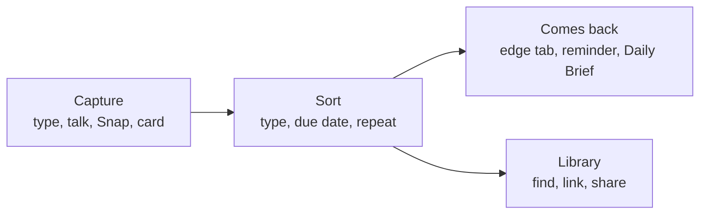

# Quicknote

Quicknote is a free menu-bar app for macOS that catches a thought in a second and brings it back when it matters. Type it, say it, snap it or make a card from it. Quicknote picks a type, finds the date, and keeps it on a small tab at the edge of your screen until you are done. Everything stays on your Mac. There is no account, no sync service and no analytics.



## What it does

**Capture**
- Press `⌃⌥N`, type, press `↵`. [Capture](docs/features/capture.md)
- Hold `⌃⌥K`, speak, let go. Speech is recognised on this Mac. [Voice](docs/features/voice.md)
- `⌃⌥S` saves where you stopped: Done, Blocked, Next. [Capture](docs/features/capture.md)

**Notes that come back**
- Quicknote reads "Call Jonah tomorrow at 10" as an event and "water plants every tue and thu" as a repeating task. [Sorting and repeats](docs/features/sorting-and-repeats.md)
- Notes wait as coloured tabs on the screen edge. Pin a note to an app or website and it slides out when you are there. [Edge tabs](docs/features/edge-and-context.md)
- Reminders and snooze arrive as notifications. [Reminders](docs/features/reminders-and-brief.md)

**Meetings**
- Record your microphone and your Mac's audio, bookmark moments with `⌃⌥B`, and get a transcript, an on-device summary and action items. [Meetings](docs/features/meetings.md)

**Snap**
- `⌃⌥4`, drag a box around anything on screen, mark it up with arrows, shapes, text, steps and blur, then share it. [Snap](docs/features/snap.md)

**Cards**
- `⌃⌥C` makes a card (sticky, postcard, polaroid, lined, minimal, kraft) you can decorate and export as a PNG. [Cards](docs/features/cards.md)

**Organise**
- Types, projects, `[[links]]` between notes with backlinks, and light formatting. [Notes, links, formatting](docs/features/notes-links-formatting.md), [Library](docs/features/library.md), [Editor](docs/features/editor.md)

**Search**
- `⌃⌥F` searches your notes, meeting transcripts, and file names and text read from images. It searches only Quicknote's own data. [Search](docs/features/search-and-export.md)

**Calendar**
- A note with a due time offers to add an event. Nothing is written until you confirm, and edits stay in sync both ways. The Daily Brief lists today. [Calendar and Brief](docs/features/calendar-and-brief.md)

**Privacy**
- On-device only, offline, no cloud, no analytics. [Privacy](docs/privacy.md)

Quicknote shows nothing you did not ask for: no greetings, no pop-ups. Only a reminder you set, or a note you pinned to the app in front, appears by itself ([decision 5](docs/decisions/0005-nothing-pops-up-unasked.md)).

## Requirements

- macOS 26 or later ([decision 2](docs/decisions/0002-macos-26-and-later.md)). Whether a Mac can run macOS 26 decides whether it can run Quicknote.
- Meeting summaries need Apple Intelligence on the Mac. Everything else works without it.

## Install

Download the DMG from the GitHub releases page and drag Quicknote to Applications. Releases are signed, notarized and published as described in [docs/release.md](docs/release.md); Quicknote is not in the Mac App Store ([decision 8](docs/decisions/0008-developer-id-distribution.md)). Installed copies update themselves with Sparkle.

## Build from source

You need Xcode 27.

```sh
scripts/bootstrap.sh          # installs XcodeGen, generates Quicknote.xcodeproj, resolves packages
open Quicknote.xcodeproj      # run the Quicknote scheme
scripts/test.sh               # QuicknoteKit tests, then the app tests
```

More in [docs/development.md](docs/development.md).

## Shortcuts

| Shortcut | Does |
|---|---|
| `⌃⌥N` | New note |
| `⌃⌥K` | Hold to talk |
| `⌃⌥4` | Snap |
| `⌃⌥C` | New card |
| `⌃⌥F` | Search |
| `⌃⌥S` | Save where I stopped |
| `⌃⌥B` | Bookmark meeting moment |

Change any of them in Settings › Shortcuts. All keys: [docs/shortcuts.md](docs/shortcuts.md).

## Privacy

- Notes, voice, screenshots and recordings stay in `~/Library/Application Support/Quicknote`.
- Speech is recognised with Apple's on-device `SpeechAnalyzer`. Summaries use the on-device system language model.
- The only network use is Apple's one-time speech model download and Sparkle's update check.
- Export or delete everything in Settings › Data.

Details: [docs/privacy.md](docs/privacy.md).

## Documentation

- [User guide](docs/user-guide.md), [shortcuts](docs/shortcuts.md), [FAQ](docs/faq.md), [privacy](docs/privacy.md), [permissions](docs/permissions.md)
- [Index of all docs](docs/README.md), [architecture](docs/architecture.md), [decisions](docs/decisions/)

## Contributing

- Read [docs/development.md](docs/development.md) first.
- Lint with `scripts/lint.sh`, test with `scripts/test.sh`.
- Logic with no UI goes in `QuicknoteKit/`. Windows and system integrations go in `Quicknote/<Feature>/`.
- Each feature has one page in [docs/features/](docs/features/), updated in the same commit as the code.

Licence: to be decided
