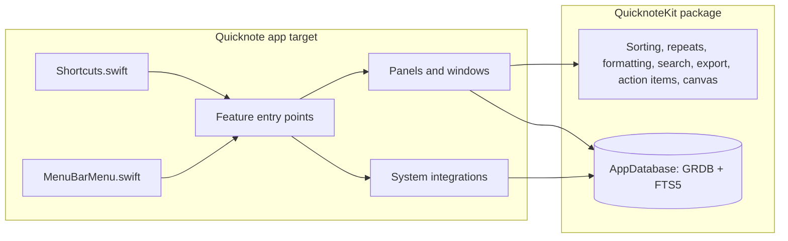
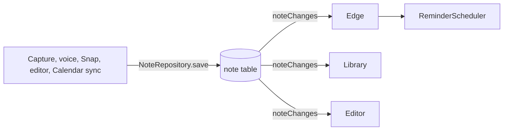

# Architecture

Quicknote is a menu bar app (`LSUIElement`) with no server. Everything it stores is under `~/Library/Application Support/Quicknote/`: one SQLite database (`quicknote.sqlite`) and an `Attachments/` folder. Preferences are in UserDefaults.

## Entry points

| Feature | Entry point | Screens |
|---|---|---|
| Capture, Save where you stopped | `Quicknote/Capture/CaptureFeature.swift` | S04, S09 |
| Hold to talk | `Quicknote/Voice/VoiceFeature.swift` | S05 |
| Edge tabs, app and site notes, reminders | `Quicknote/Edge/EdgeFeature.swift` | S07, S08 |
| Library and editor | `Quicknote/Library/LibraryFeature.swift` | S10–S13, S16, S24 |
| Calendar and Daily Brief | `Quicknote/Brief/BriefFeature.swift` | S06, S14 |
| Search | `Quicknote/Search/SearchFeature.swift` | S15 |
| Meetings | `Quicknote/Meetings/MeetingsFeature.swift` | S17, S18 |
| Snap | `Quicknote/Snap/SnapFeature.swift` | S19, S20, S23 |
| Cards | `Quicknote/Cards/CardsFeature.swift` | S21, S22 |
| Settings, permissions, welcome | `Quicknote/Settings/SettingsView.swift`, `Quicknote/App/Permissions.swift` | S02, S03, S25, S26 |
| Updates | `Quicknote/Updates/UpdatesFeature.swift` | — |

Launch order, in `Quicknote/App/AppDelegate.swift`: `QuicknoteApp` → `applicationDidFinishLaunching` → `AppEnvironment.start()` (opens the database; on failure an alert says where the notes are and the app quits) → `removeOrphanedAttachments()` (background task) → `Shortcuts.register()` → `EdgeFeature.start()` → `CalendarBridge.shared.resumeSyncingIfAllowed()` → `UpdatesFeature.start()` → `WelcomeFeature.showIfFirstLaunch()`. Unit tests host the app, so nothing runs when `AppEnvironment.isRunningTests`.

## Folders

`Quicknote/` (app target), one folder per feature:

| Folder | Holds |
|---|---|
| `App/` | Entry point, menu, `Shortcuts`, `Permissions`, `AppEnvironment` |
| `Capture/`, `Voice/` | Capture panels, hold to talk, `LiveTranscriber` |
| `Edge/`, `Context/`, `Reminders/` | Edge tabs, frontmost app and browser page, notification scheduling |
| `Library/`, `Editor/` | Library window and note editor |
| `Brief/`, `Calendar/` | Daily Brief, EventKit bridge and confirmation |
| `Search/` | Search panel |
| `Meetings/` | Recorder, summaries, meeting window |
| `Snap/`, `Canvas/`, `Cards/` | Screen capture, shared canvas drawing, card editor |
| `Attachments/` | File import and image text reading |
| `Export/` | Share menu |
| `Settings/`, `Welcome/`, `Updates/` | Settings window, first launch, Sparkle |

`QuicknoteKit/Sources/QuicknoteKit/` (no UI): `Store`, `Notes`, `Sorting`, `Editor` (formatting rules), `Edge`, `Context`, `Reminders`, `Search`, `Attachments`, `Export`, `Meetings`, `Canvas`, `Cards`.

## Data flow

Features write through repositories (`NoteRepository.save`, `MeetingRepository`) and never tell each other about changes. Views that must stay current watch the database instead: `AppDatabase.noteChanges()` (`QuicknoteKit/Sources/QuicknoteKit/Notes/NoteChanges.swift:5`) is an `AsyncStream` of every note, sent once and again after each change to the `note` table. The edge (`EdgeController.observeNotes`), the Library (`LibraryModel.observe`) and the editor (`NoteEditorModel.observeChanges`) use it. `ReminderScheduler` follows the edge. This is why a change made by Calendar sync, a notification button or another window shows up without a refresh.

## Data

The schema lives in `QuicknoteKit/Sources/QuicknoteKit/Store/AppDatabase.swift`; records in `Records.swift`.

| Table | Holds |
|---|---|
| `note` | Every capture: body, type, colour, font, due date, repeat, snooze, the app and site it came from, calendar event id, canvas JSON for Snaps and Cards, the meeting moment an action item came from |
| `project` | Named groups of notes |
| `attachment` | Files copied into `Attachments/`, with text read from images |
| `noteLink` | `[[links]]` between notes, rebuilt on every save |
| `meeting`, `transcriptSegment`, `meetingBookmark` | Recordings, timed transcript lines (me or others), bookmarks |
| `note_ft`, `transcriptSegment_ft`, `attachment_ft` | FTS5 search indexes kept in sync by GRDB |

## Decisions

Recorded in [decisions/](decisions/).
