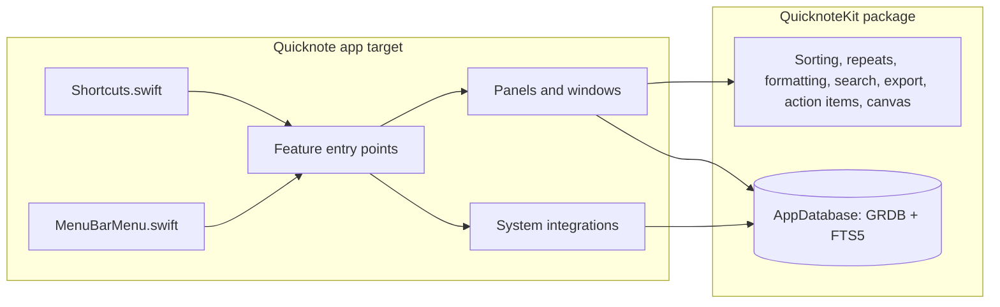

# Architecture

Quicknote is a menu bar app (`LSUIElement`) with no server. Everything it stores is under `~/Library/Application Support/Quicknote/`: one SQLite database and an `Attachments/` folder.

## Entry points

| Feature | Entry point | Screens |
|---|---|---|
| Capture, Save where you stopped | `Quicknote/Capture/CaptureFeature.swift` | S04, S09 |
| Hold to talk | `Quicknote/Voice/VoiceFeature.swift` | S05 |
| Edge tabs, app and site notes, reminders | `Quicknote/Edge/EdgeFeature.swift` | S07, S08 |
| Library and editor | `Quicknote/Library/LibraryFeature.swift` | S10–S13, S16, S24 |
| Calendar and Daily Brief | `Quicknote/Brief/BriefFeature.swift` | S06, S14 |
| Search | `Quicknote/Search/SearchFeature.swift` | S15 |
| Meetings | `Quicknote/Meetings/MeetingsFeature.swift` | S17, S18 |
| Snap | `Quicknote/Snap/SnapFeature.swift` | S19, S20, S23 |
| Cards | `Quicknote/Cards/CardsFeature.swift` | S21, S22 |
| Settings, permissions, welcome | `Quicknote/Settings/SettingsView.swift`, `Quicknote/App/Permissions.swift` | S02, S03, S25, S26 |
| Updates | `Quicknote/Updates/UpdatesFeature.swift` | — |

Launch order: `QuicknoteApp` → `AppDelegate.applicationDidFinishLaunching` → `AppEnvironment.start()` (opens the database) → `Shortcuts.register()` → `EdgeFeature.start()` → `UpdatesFeature.start()` → `WelcomeFeature.showIfFirstLaunch()`.

## Data

The schema lives in `QuicknoteKit/Sources/QuicknoteKit/Store/AppDatabase.swift`; records in `Records.swift`.

| Table | Holds |
|---|---|
| `note` | Every capture: body, type, colour, font, due date, repeat, snooze, the app and site it came from, calendar event id, canvas JSON for Snaps and Cards, the meeting moment an action item came from |
| `project` | Named groups of notes |
| `attachment` | Files copied into `Attachments/`, with text read from images |
| `noteLink` | `[[links]]` between notes, rebuilt on every save |
| `meeting`, `transcriptSegment`, `meetingBookmark` | Recordings, timed transcript lines (me or others), bookmarks |
| `note_ft`, `transcriptSegment_ft`, `attachment_ft` | FTS5 search indexes kept in sync by GRDB |

## Decisions

Recorded in [decisions/](decisions/).
