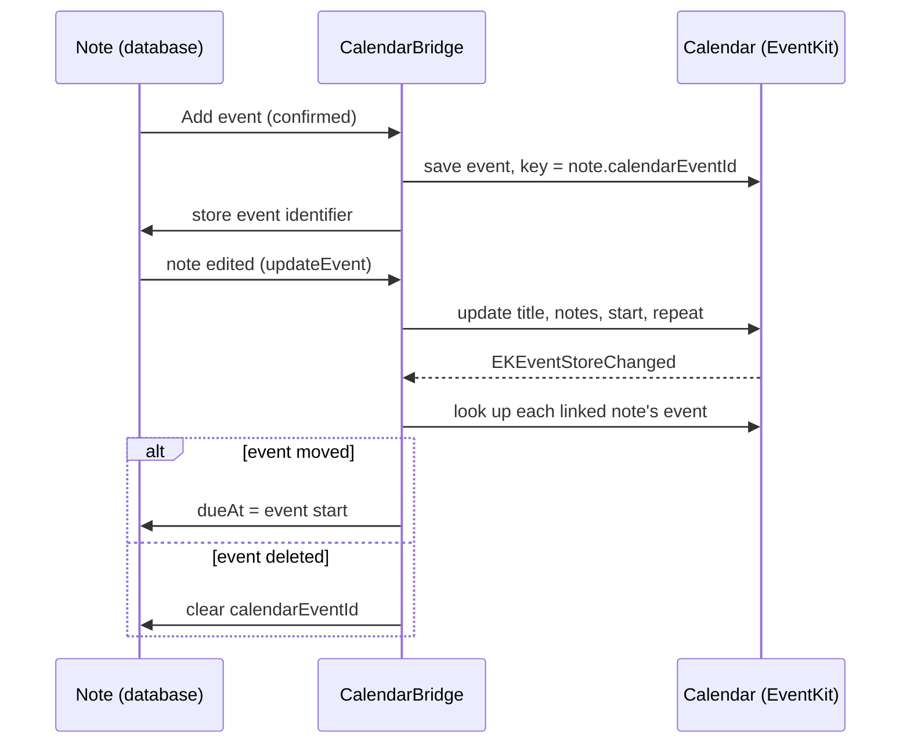

# Calendar and the Daily Brief

## What you can do

- Put a due **time** on a note and Quicknote asks "Add to Calendar?" (S06). Edit the title, date, time, duration (default 30 min) and calendar, then **Add event**, or **Keep as note only**.
- Edit the note later and its event follows. Move or delete the event in Calendar and the note follows.
- Open the **Daily Brief** (S14) from the menu: today's events, due tasks you can check off, overdue items and notes coming back. **Read aloud** speaks it; the button turns into **Stop**.

## The confirmation rule

Nothing is written to Calendar until you press **Add event** ([decision 0006](../decisions/0006-calendar-full-access.md)). Notes without a due time (date only or none) never show the panel. A date-only note that is later pushed with `updateEvent` becomes an all-day event.

## Staying in sync

Rule (`EventSyncRule.reconciled`): a moved event sets the note's `dueAt`; a missing event clears `calendarEventId`; a difference under 1 second is ignored. Only open notes are checked. Deleting the note's event from Quicknote (`deleteEvent`) removes all repeats and keeps the note.

Repeats map from `RecurrenceRule`: daily, weekly (with weekdays), every N weeks, monthly, yearly.

## Which calendars appear

Every event calendar you can write to, including Google and Outlook accounts synced into Apple Calendar. Read-only and subscribed calendars are hidden. The last calendar you chose is the default next time, then the system default.

## The Brief

Sections, in order: Events, Due today, Overdue, Coming back today (built by `DailyBriefBuilder`, see [reminders-and-brief.md](reminders-and-brief.md)). Check a task to complete it (a repeating task moves to its next date); check it again to reopen. Click a row to open the note in the Library. It refreshes live: on any Calendar change, after your own check-offs, and every 5 seconds while open. It opens only from the menu ([decision 0005](../decisions/0005-nothing-pops-up-unasked.md)).

## Permissions

Full calendar access (`NSCalendarsFullAccessUsageDescription`), asked at first use: the first "Add to Calendar?" or the first time the Brief opens. Full access is needed to read events back ([decision 0006](../decisions/0006-calendar-full-access.md)). Without it the Brief still opens, without events, and no panel appears.

## Code

- Entry points: `Quicknote/Calendar/CalendarConfirmation.swift:11` (`present(forNoteId:)`), `Quicknote/Brief/BriefFeature.swift:8` (`show()`)
- Calendar access: `Quicknote/Calendar/CalendarBridge.swift:20` (`ensureAccess`), `:43` (`saveEvent`), `:57` (`updateEvent`), `:67` (`deleteEvent`), `:77` (`eventsToday`), `:86` (`startSyncingFromCalendar`)
- Pure mapping: `Quicknote/Calendar/EventDraft.swift` (`EventDraft`, `RecurrenceRule.eventKitRule`, `BriefEvent.init(event:)`, `EventSyncRule`)
- Brief: `Quicknote/Brief/BriefModel.swift:28` (`toggle`), `:39` (`toggleReadAloud`), `Quicknote/Brief/BriefView.swift`
- Tests: `QuicknoteTests/CalendarMappingTests.swift`

## Limits

- Syncing back starts after the first calendar access in a session (first confirmation or Brief). Changes made in Calendar while Quicknote was closed are applied the next time that happens and an `EKEventStoreChanged` arrives.
- For repeating events only the first occurrence's start is compared.
- Completed notes are not synced; a note moved by an event edit does not re-run reminders until the planner next runs.
- Updating a note's event does not ask again; the confirmation is only for creating it.

## Manual test checklist

- [ ] Set a due time on a note: the panel shows, nothing is in Calendar yet.
- [ ] **Keep as note only**: no event appears.
- [ ] **Add event** with another calendar and 60 min: the event is there with the right title, notes, link and length.
- [ ] Add a note with only a date: the panel does not appear.
- [ ] Move the event in Calendar: the note's due time changes.
- [ ] Delete the event in Calendar: the note stays and no longer has an event.
- [ ] A weekly note on Mon and Wed makes a repeating event.
- [ ] A Google calendar synced in Calendar is listed.
- [ ] Deny access: the Brief opens without events.
- [ ] Brief: check a task, it strikes through; check again, it reopens. Click a row, the Library opens the note.
- [ ] Add an event in Calendar while the Brief is open: it appears.
- [ ] **Read aloud** speaks; **Stop** stops; closing the window stops.
- [ ] The Brief never opens by itself.
