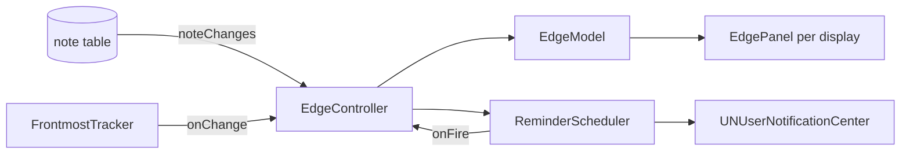

# Edge tabs, app and site notes, reminders

Notes wait as small coloured tabs on the right edge of your screen. Nothing else pops up on its own ([decision 0005](../decisions/0005-nothing-pops-up-unasked.md)): the edge slides out only for notes you pinned to the app in front, and for reminders you set.

## What you see and do

- **Tabs.** One tab per note on the edge, in the note's colour, on every display (or only the main one, Settings). The panel is only as big as its tabs, so the rest of the screen stays click-through. Too many tabs for the screen height end in a grey `+N` tab that opens the Library.
- **Peek.** Hover a tab to see the note card; move away and it hides.
- **Open.** Click a tab (or focus it with the keyboard and press Space). The card shows **Done**, **Snooze** (15 minutes, 1 hour, This evening, Tomorrow morning, Next week, each with its time), **Open in Library** and **Remove from edge**. Click the tab again or press Esc to close.
- **Remove by dragging.** Drag a tab left, away from the edge, to take the note off the edge (`onEdge = false`). The note stays in the Library. VoiceOver users get a "Remove from edge" action on each tab.
- **Pinned to an app or site.** A note pinned to an app or site shows only while that app (or site, in a supported browser) is in front. When you switch to it, a card "For Slack" slides out listing those notes; tick one to mark it done. A coloured tab with the count stays so you can close or reopen the card. In other apps they hide. Turn this off with "pops up context notes" in Settings; the notes then show as plain tabs while their app is in front.
- **Reminders coming back.** A note with a due time, or a snoozed note, sends a notification at that time with **Done** and **Snooze 1 hour**. At the same moment the note slides out on the edge with a small bounce (a plain fade with Reduce Motion). Clicking the notification opens the note on the edge.
- **Hide for an hour.** `EdgeFeature.hideForOneHour()` hides every edge panel; they return by themselves. Notifications still arrive.

Done on a repeating note moves it to its next occurrence instead of completing it ([sorting-and-repeats.md](sorting-and-repeats.md)); it stays on the edge.

## Permissions, and exactly when

| Permission | Asked | Never asked |
|---|---|---|
| Notifications | `Permissions.ensure(.notifications)` the first time there is something to schedule (a timed note or a snooze). Not at launch. | When nothing is scheduled |
| Accessibility | Not requested by this feature. If you already granted it, the browser page is read from it. | Never from polling or capture |
| Automation (Apple Events) | Once per browser, by the system, the first time you capture while that browser is in front. | Never from background polling |

Without Accessibility and Automation, Quicknote still records the app, just not the site; notes pinned to a site then do not match, notes pinned to the browser app do.

## How it works

Entry point: `Quicknote/Edge/EdgeFeature.swift` `start()` (called at launch) → `EdgeController.start` (`Quicknote/Edge/EdgeController.swift:14`).

| Step | Code |
|---|---|
| Edge follows the database by itself | `AppDatabase.noteChanges` (`QuicknoteKit/Sources/QuicknoteKit/Notes/NoteChanges.swift:5`), consumed in `EdgeController.observeNotes` (`:60`) |
| Redraw | `EdgeController.reload` (`:27`) → `EdgeModel.update` (`Quicknote/Edge/EdgeModel.swift:33`, uses `EdgeFilter`) → `EdgePanel.sync` (`Quicknote/Edge/EdgeWindow.swift:36`) |
| Panel size and tab positions | `EdgeLayout.init` (`QuicknoteKit/Sources/QuicknoteKit/Edge/EdgeLayout.swift:22`) |
| One panel per display, rebuilt on screen changes | `EdgeController.rebuildPanels`, `observeScreens` |
| Panel behaviour (non-activating, all Spaces, over full-screen apps) | `EdgePanel.init` (`Quicknote/Edge/EdgeWindow.swift:15`) |
| Tabs, peek, drag to remove | `EdgeTabsView` (`Quicknote/Edge/EdgeTabsView.swift:25`), `setPeek` (`:77`), `onDragAwayFromEdge` (`:112`) |
| Done, snooze, remove, open | `EdgeActions` (`Quicknote/Edge/EdgeActions.swift`), all through `NoteRepository.save` |
| Frontmost app and page | `FrontmostTracker.refresh` (`Quicknote/Context/FrontmostTracker.swift:23`), `FrontmostContext.current()` |
| Which browser, which source | `BrowserURLStrategy.strategy` (`QuicknoteKit/.../Context/BrowserContext.swift:22`), `URLReadPolicy.sources` (`:45`), `SiteHost.host` (`:5`) |
| Reading the page | `BrowserURLReader.currentURL` (`Quicknote/Context/BrowserURLReader.swift:10`): Accessibility `AXWebArea`'s `AXURL` (`:39`), then Apple Events (`:65`) |
| Scheduling | `ReminderScheduler.update` (`Quicknote/Reminders/ReminderScheduler.swift:33`) removes all pending `app.quicknote.reminder.*` requests and adds the plan from `ReminderPlanner.plannedAlerts` |
| Slide out at fire time | `fireDueAlerts` (`:74`) → `onFire` → `EdgeController.reveal` (`:45`) |
| Notification buttons | `handle` (`:81`) → `ReminderAction.apply` (`QuicknoteKit/.../Reminders/ReminderAction.swift:8`) → `NoteRepository.save` |

Site host is the URL host without a leading `www.`; non-web URLs give none. The tracker ignores Quicknote itself, so the context is the app you were in before.

## Limits

- Browsers: Safari (and Technology Preview), Chrome, Arc, Brave, Edge by Apple Events and Accessibility; Firefox by Accessibility only (it has no scripting).
- Chrome-family browsers often do not expose the page to Accessibility; they rely on Automation.
- While a browser is in front its page is re-read every 3 seconds, on the main thread, with a 1 second Apple Events timeout. A hung browser can stall the UI for that long.
- Pinned notes for a site pop out when you change page within 3 seconds, not instantly.
- At most 60 notifications are scheduled (the system allows 64 per app).
- "Pick a time…" in the snooze menu (S08) is not built; the five fixed choices are.
- With several displays, a card opened on one display opens on all of them.
- A snoozed or reminder note alerts only while Quicknote runs for the slide-out; the notification itself is delivered by the system either way.

## Manual test checklist

- [ ] Two displays: tabs on both; Settings "all displays" off leaves only the main one; unplug/replug a display and the tabs follow.
- [ ] Full-screen app: tabs stay visible on the right edge; clicking a tab does not switch Spaces or steal focus.
- [ ] Several Spaces: tabs appear on every Space.
- [ ] Click anywhere on the screen outside the tabs: it reaches the app underneath (also with a card open, outside the card).
- [ ] Hover peeks, click opens, Esc closes, drag left removes and the note is still in the Library.
- [ ] 20 notes on a short display: `+N` tab appears and opens the Library.
- [ ] Pin a note to Slack: it slides out in Slack, hides in Xcode. Pin to `figma.com`: it slides out on that site in Safari.
- [ ] Accessibility off, Automation not granted: pinned-to-site notes do not pop; the app is still recorded; no system prompt appears while browsing.
- [ ] Capture in Chrome: the Automation prompt appears once; afterwards the site is recorded.
- [ ] A reminder due in one minute: the notification arrives, the note slides out with a bounce; Done and Snooze 1 hour work from the notification. Repeat with Reduce Motion on.
- [ ] First timed note ever: the notifications permission is asked then, not at launch.
- [ ] Hide for an hour hides all panels and they return afterwards.
- [ ] Keyboard only (Full Keyboard Access): tabs and card buttons can be reached and used; VoiceOver reads each tab's label.
